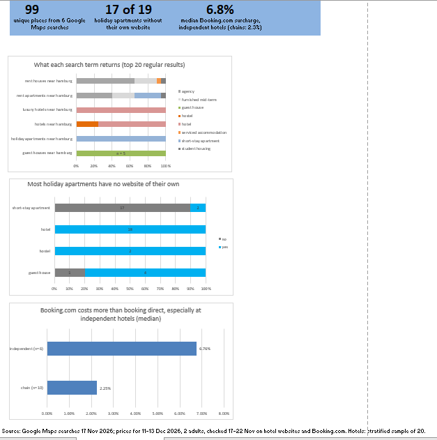
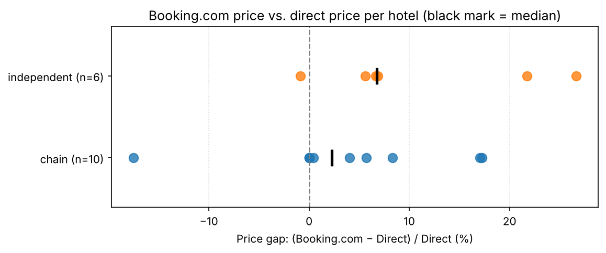

# Hamburg accommodation: Google Maps search results and direct vs. Booking.com prices

A small data project that follows the traveller's journey: **search on Google Maps → open a result → check the hotel's own website → compare with Booking.com.**
It looks at what different search terms actually return, who sells only through platforms, and whether booking direct is cheaper.

**Tools:** Excel (pivot tables, formulas, dashboard) · Python (pandas, matplotlib) for validation
**Author:** Yameen Mohammad · M.Sc. Information and Electrical Engineering, Hochschule Wismar
**Status:** completed November 2026

---

## Questions

1. What does a traveller actually get for common accommodation searches around Hamburg?
2. Which properties have their own booking website, and which sell only through platforms?
3. Is it cheaper to book directly with the hotel or through Booking.com, and does that differ between chains and independent hotels?

## Data and method

| Item | Detail |
|---|---|
| Source | Google Maps (web), collected manually on 17 Nov 2026 |
| Searches | 6 terms, all "… near hamburg": holiday apartments, guest houses, hotels, luxury hotels, rent apartments, rent houses |
| Sample | Top 20 regular (non-sponsored) results per search; ads recorded separately. Holiday apartments ended at 19 results, guest houses at 5 |
| Size | 116 search rows (104 regular + 12 ad rows) → **99 unique properties** after removing duplicates |
| Stay used for prices | Fri 11 – Sun 13 Dec 2026, 2 adults; prices per night (total ÷ 2) |
| Price checks | Hotel's own website and Booking.com, both checked on the same day (17 Nov for apartments and guest houses, 20–22 Nov for hotels) |
| Hotel sample | Stratified sample of 20 hotels (hostels, chains, independent 4-star, 5-star); the other 20 hotels are marked "not sampled (time)" |

**Rules used during collection**
- *Own website* = the property's or chain's official site. Comparison and rental portals (e.g. BluePillow, Holidu, e-domizil) do not count. Properties without an own website were not priced, because there is no direct price to compare.
- *Direct price* = the cheapest **public** rate (no login). Member/club rates are recorded separately (`price_direct_member`).
- Same room type on both channels where possible; differences are noted. Flexible vs. non-refundable is noted for each price.
- If 11–13 Dec was unavailable, the nearest dates were used and the row is flagged `DATES`.
- *Chain* = a big brand with many hotels (e.g. IHG, Accor, Radisson, Marriott, Motel One, Premier Inn, Scandic, MEININGER, a&o, Generator, IntercityHotel). Everything else = *independent*.
- *Price gap* = (Booking.com − direct) / direct. Positive = Booking.com more expensive.

## Findings

1. **Booking.com was more expensive than booking direct, especially at independent hotels.** Median gap: **+6.8% for independent hotels (n=6)** vs. **+2.3% for chains (n=10)** (averages 11.1% vs. 3.5%). Most chains sat close to parity (6 of 10 between 0% and 6%). Their direct advantage was mostly a member discount, extras (e.g. free breakfast) or free cancellation rather than a lower public price.
2. **Holiday apartments depend on platforms.** 17 of 19 had no website of their own and sold only via Booking.com, other platforms or comparison sites in front of them.
3. **Guest houses have websites but rarely take online bookings.** 3 of 4 guest-house websites accepted enquiries only.
4. **Search terms don't always deliver what they promise.** "rent houses near hamburg" returned no houses: 13 of 20 results were agencies. "luxury hotels" returned mostly 4-star hotels (8 of 20 were 5-star).
5. **Ads showed higher prices.** In all 3 cases where a hotel appeared both as an ad and as a regular result, the ad price was higher (e.g. €644 vs. €585 per night).
6. **Background effects seen in the data:** Booking.com paid part of a discount itself to undercut a hotel's own site ("Booking.com pays"), and one 5-star chain hotel's Maps website link led to a third-party site instead of its own booking page.

## Recommendations

**For travellers**
- Check the hotel's own website before booking, especially for independent hotels.
- At chain hotels, a free membership often gives a lower price than Booking.com (e.g. €177 vs. €205 per night in this sample).
- Compare the conditions, not only the price: at the same price, booking direct sometimes included free cancellation or breakfast.
- Scroll past ads, and use precise search terms ("holiday apartment" instead of "rent house").

**For independent hotels and small hosts**
- Offer online booking on the own website; enquiry-only sites lose guests who want to book instantly.
- Link the Google Maps profile directly to the booking page and show the direct price where guests compare (e.g. Google's free booking links).
- Website builders with booking engines and calendar sync already exist; the gap in this sample was adoption and visibility, not technology.

## Limitations

- Small sample: 16 hotels in the price comparison, one city, one stay. Results are indicative, not representative.
- Google Maps results vary with date, location and account.
- Prices were checked over 17–22 Nov; 6 properties were priced for 13–15 Dec (3 of them in the 16-hotel comparison).
- A few room types differ between channels (noted in `price_notes`); city tax is shown inconsistently across sites.
- Member-only direct prices (3 hotels) are not part of the gap calculation.

## Critical review: questions a sceptical reader should ask

| Question | Answer from the data |
|---|---|
| **Is the chain vs. independent difference just noise?** | It could partly be. With n=6 and n=10, no statistical test would be meaningful. But the direction is consistent: 5 of 6 independent hotels were cheaper direct, while among chains 6 were cheaper direct, 3 equal and 1 cheaper on Booking.com. Treat it as a clear indication, not proof. |
| **Does the result depend on how hotels were labelled?** | Two labels were judgement calls (PIERDREI, GINN → independent). Without them, the independent median stays at 6.8%. If both were counted as chains, the chain median rises to 4.8%, still below the independent median. |
| **What if member prices are counted as the direct price?** | Then chains look much better: the median gap for chains rises from 2.3% to 5.3% (13 hotels incl. 3 with member-only rates), close to the independent 6.8%. So the finding is about **public** prices: at chains, the direct saving mostly goes to members. |
| **Were the prices really comparable?** | Both channels were checked on the same day for each property, with the same room type where possible. Exceptions are flagged in `price_notes`: different room names (GINN, Fontenay), dorm beds instead of double rooms (MEININGER, a&o), different rate conditions (e.g. flexible direct vs. unknown on Booking.com), and 6 rows priced for 13–15 Dec. |
| **Does city tax distort the gap?** | Only slightly. City tax was included on some sites and not on others (a few euros per stay). Booking.com prices more often excluded it, so if anything the true Booking.com cost is a little higher and the gap is understated. |
| **Are the Google Maps results representative?** | No. They come from one browser session, one location and one date. Another user or date may see different results and ranks. The point is to show what one realistic search looks like, not to rank all Hamburg properties. |
| **Can someone check this?** | Yes. Every price has a note in the Properties sheet, all rules are written above, and the notebook recalculates the key figures from the raw columns. Prices will have changed since November 2026, so a re-check would need new dates. |

**Next step:** repeat the price comparison for several dates and a larger hotel sample to check whether the gap holds.

## Files

| File | Content |
|---|---|
| `hamburg_maps_search_study.xlsx` | Data (Searches, Properties), pivot tables, Dashboard, Notes |
| `hamburg_validation.ipynb` | Python checks and independent recalculation of the key figures |
| `gap_by_hotel.png` | Price gap per hotel (from the notebook) |
| `dashboard.png` | Screenshot of the Excel dashboard |

**How to run the notebook:** put the Excel file in the same folder, install `pandas`, `matplotlib` and `openpyxl`, then run all cells. All checks should print `PASS`, and the medians should match the Excel dashboard (2.3% / 6.8%).

## Validation (Python)

| Check | Result |
|---|---|
| Unique property IDs | PASS |
| Every search row links to a property | PASS |
| Regular results per search (20/19/5/20/20/20) | PASS |
| Prices plausible (0 < price ≤ €1,000) | PASS |
| Gap recalculated in Python = Excel `gap_pct` | PASS (difference 0.0) |

## Data dictionary

**Searches** (one row per result per search)

| Column | Meaning |
|---|---|
| `query` | Search term used on Google Maps |
| `rank` | Position among regular results (empty for ads) |
| `sponsored` | yes = ad, no = regular result |
| `property_id` | Link to the Properties sheet (P001–P099) |
| `name` | Name as shown on Maps |
| `google_category` | Category as shown by Google |
| `stars`, `rating`, `review_count` | As shown on Maps (empty if not shown) |
| `sleeps`, `bedrooms` | For apartment listings |
| `maps_price_eur_night` | Price shown on Maps (per night, Google's own source) |
| `has_website` | Website button shown (rent searches only) |
| `place_id`, `lat`, `lon` | Google place ID and coordinates (only where the link was copied) |
| `offer_type` | Own classification: short-stay apartment, guest house, hotel, hostel, agency, furnished mid-term, student housing, serviced accommodation, other |
| `note` | Observations (ads, location, missing values) |

**Properties** (one row per unique property)

| Column | Meaning |
|---|---|
| `property_id` | Unique ID |
| `name`, `offer_type`, `google_category`, `stars`, `rating`, `review_count`, `sleeps`, `bedrooms`, `address`, `place_id`, `lat`, `lon` | From Searches (first non-empty value) |
| `to_price` | yes = to be priced; optional; no (agencies, mid-term rentals) |
| `searches` | Searches in which the property appeared |
| `n_searches` | Formula: number of appearances in Searches (ads included) |
| `best_rank` | Best position among regular results |
| `maps_price_eur_night` | Maps price from the regular result |
| `has_website` | Own booking website: yes / no |
| `price_direct` | Cheapest public price on the own website (EUR/night) |
| `price_direct_member` | Member/club price on the own website (EUR/night) |
| `price_booking` | Booking.com price, same stay (EUR/night) |
| `price_airbnb` | Not used (empty) |
| `price_notes` | Room type, rate conditions, taxes, date flags (`DATES`), "not sampled (time)" |
| `cheapest_channel` | Formula: lowest of the price columns (ties show the first column) |
| `gap_pct` | Formula: price_booking / price_direct − 1 |
| `hotel_group` | chain / independent / guest house / apartment (for the gap analysis) |

## Change log

| Date | Change |
|---|---|
| 17 Nov 2026 | Collected 6 Google Maps searches (date filter 11–13 Dec, 2 adults); set rules for ads, ranks and duplicates |
| 17 Nov 2026 | Built Searches and Properties sheets; removed duplicates → 99 properties. Priced holiday apartments and guest houses |
| 20–22 Nov 2026 | Priced the stratified hotel sample (20 hotels); added `price_direct_member` for member/club rates; marked 20 hotels "not sampled (time)" |
| 22 Nov 2026 | Added `gap_pct` and `hotel_group`; built pivot tables, median table and Dashboard |
| 22 Nov 2026 | Fixed `gap_pct` so missing prices stay blank; corrected chain/independent labels with a written chain definition; restored a deleted row (P029) and formulas overwritten by a paste-values step |
| 22 Nov 2026 | Python validation notebook: all checks passed; key figures reproduced |

---

*Data was collected manually from public listings for a non-commercial study. Prices are a snapshot and will have changed.*
